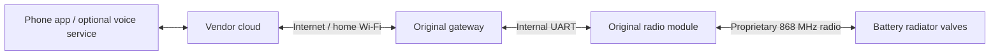
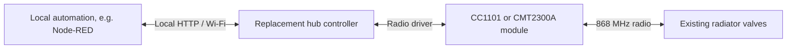

# Heating Hub Protocol

**Cloud-independent communication with Saswell-family 868 MHz radiator valves.**

This repository documents an independently investigated radio protocol and the
experiments that led to a working replacement heating hub. It is intended for
developers who want to build their own implementation, not just reproduce one
particular ESP32 firmware.

**Research snapshot: 8 November 2026. Initial documentation edition.**
The associated operating installation has controlled valves without its original
cloud gateway for several days. This is not a universal compatibility claim for
every product sold under the same name. A finished configurable firmware release
is a separate project; this repository contains protocol notes and offline tools.

## What system is this about?

The investigated system is the **Saswell SEA801-DF1 / SEA801-APP family with a
SASWG-04-WIFI(TY)-style gateway**, using proprietary **868 MHz** radio traffic.
Model names are reused across radio and firmware variants. Identify the actual
hardware and capture its traffic; do not substitute a Zigbee manual or assume
that a product listing proves protocol compatibility.

The original arrangement was:



The replacement removes the original gateway/cloud from the **heating radio
control path**:



Optional remote voice/notification services can still depend on a cloud. The
valves also retain their own local weekly schedules; removing the gateway does
not erase those schedules.

## Read this first

| Document | Contents |
|---|---|
| [System and scope](docs/01-system.md) | Hardware identification, original cloud path, capabilities and limits |
| [How we investigated it](docs/02-investigation.md) | UART taps, SDR/IQ, independent comparisons, controlled tests, failed leads |
| [Frame format](docs/03-frame-format.md) | Binary header, length, identifiers, checksum, command catalogue |
| [Radio layer](docs/04-radio.md) | Frequency, modulation, preamble, sync, outer length, working profiles |
| [Dialogues and timing](docs/05-dialogues.md) | Status replies, presence/hourly exchanges, beacons, program upload |
| [Implementing another hub](docs/06-implementation.md) | Receive-first commissioning, scheduling, setpoint policy, recovery |
| [Reference hardware](docs/07-hardware.md) | ESP32 wiring, CMT three-wire SPI, UART, optional SD/display |
| [Evidence ledger](docs/08-evidence.md) | Dated findings and exactly what each test demonstrates |
| [Open questions](docs/09-open-questions.md) | Unknown fields, pairing, program requests, variants and reproducible next tests |
| [Sources](docs/10-references.md) | Manufacturer documents and scope of their claims |
| [Command field maps](docs/commands/README.md) | Byte-offset tables for all observed command forms |

## Essential parameters

| Item | Observed or working value |
|---|---|
| Original internal UART | **19,200 baud, 8 data bits, no parity, 1 stop bit** |
| Working replacement RF centre | **868.110 MHz**; original captures approximately 868.095 MHz in one measured set |
| Working RF modulation | **GFSK, BT = 0.5**, binary frequency states |
| RF data rate | **50 kbit/s**, nominal **20 us per bit** |
| Working frequency deviation | **+/-28.56 kHz**, not a 28.56 kHz full separation |
| Working TX preamble | **64 bits = 8 bytes**, alternating, about **1.28 ms** |
| RF sync word | **2D D4**, MSB first |
| Successful FIFO payload | **one byte N+1**, followed by **N application-frame bytes** |
| Application marker | **7E 2B** |
| Application length | **BE16 at offsets 4..5 + 7** total bytes |
| Application checksum | **sum of all previous application bytes modulo 256** |
| Normal exchange | **01-01** thermostat status -> **00-01** hub response |
| Other operating exchanges | **01-05 -> 00-05**, **01-07 -> 00-07**, periodic **00-03** |

The RF centre and modem settings above are a **tested implementation profile**,
not a register dump from the original unmarked radio. UART baud rate is not RF
bit rate. Timing references and uncertainty are explained in the linked chapters.

## Try the offline examples

Python 3.10+ and the standard library are sufficient. No radio, network connection,
third-party package or private configuration is needed.

```sh
python tools/protocol.py --examples examples/frames.json
python -m unittest discover -s tests -v
python tools/check_docs.py
```

The examples use substituted hub/valve identifiers and recomputed checksums.
They are **sanitized protocol examples, not unmodified captures or evidence that
those example identities exist**. The helpers only parse and build bytes; they
do not implement RF transmission, deadlines, commissioning or regulatory checks.

## Confidence labels

- **Confirmed:** repeatedly captured or supported by a controlled change and response.
- **Observed:** bytes or timing measured; semantic meaning remains limited.
- **Candidate:** a plausible interpretation supported by correlation, not a complete proof.
- **Unknown:** retain raw bytes; do not assign an invented meaning.
- **Implementation choice:** policy used by our replacement; not a claimed vendor rule.

An RF interrupt, a valid checksum, a driver TX completion, a gateway UART
response, and a later valve setpoint report prove different things. We keep
those distinctions throughout the documentation.

## Contributing and publication

See [CONTRIBUTING.md](CONTRIBUTING.md) for useful capture submissions and
[PUBLICATION.md](PUBLICATION.md) for publication scope.
No vendor firmware, proprietary SDK, private credentials or full household logs
are included.

**Documentation, diagrams and data presentation: CC BY-SA 4.0.**
**Python helper code and tests: GPL version 3 only.**
Both permit commercial reuse under their terms. See [LICENSE.md](LICENSE.md)
for the exact file scopes, attribution and full license texts. The objective is
to make the findings accessible and preserve downstream sharing freedoms.
