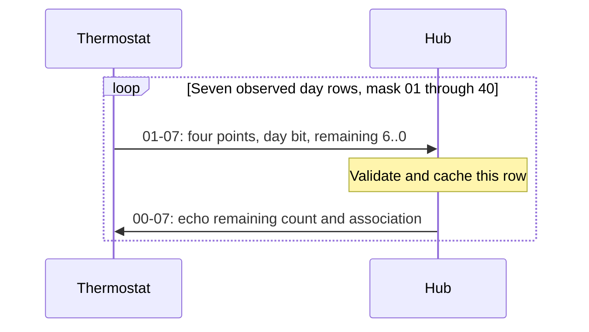

# Communication sequences and timing

## Timestamp definitions

Never compare an unspecified "reply delay" across UART and RF logs.

| Mark | Meaning |
|---|---|
| `t_sync_rx` | MCU timestamp latched by the radio's SYNC_OK interrupt; RF sync reference, not packet end |
| `t_go_tx` | MCU timestamp immediately before the GO_TX register transaction; not the first radiated symbol |
| `t_sync_tx` | Sync reference detected independently in the transmitted RF burst |
| `t_uart_first` | Timestamp associated with the first UART byte; includes transport/buffering effects |

The nominal 64-bit preamble plus 16-bit sync takes **1.6 ms** at 50 kbit/s.
Register-write time, PLL/PA behaviour and detector latency are additional factors;
adding exactly 1.6 ms to GO_TX is a useful nominal comparison, not an RF measurement.

## Normal status and optional temperature command

```mermaid
sequenceDiagram
    participant T as Thermostat
    participant H as Replacement hub
    T->>H: 01-01: current setpoint and status
    Note over H: Latch sync; validate immutable request
    H->>T: 00-01: calendar, optional absolute target
    opt Target was accepted and a follow-up was received
        T->>H: 01-01: reported setpoint matches target
        H->>T: 00-01: FF FF preserves current setpoint
    end
```

Working GO_TX target: **`t_sync_rx + 53,000 us`**. Ordinary periodic status
intervals were commonly around 120..140 seconds; not every observed gap means
the thermostat stopped transmitting. One device/location had much longer gaps.
A changed target can produce a rapid follow-up status. Do not assume every
normal status has the same follow-up timing as a setpoint-changing exchange.

00-01 offset 16..17 contains an absolute temperature in tenths C, or `FF FF` to
leave the current setpoint unchanged in the observed normal path. Reply even
when the current temperature target is already correct. A TX-completed event
is not a thermostat ACK. Confirm using a later valid 01-01 from the same
association reporting the commanded setpoint; repeat the target on subsequent
requests while it remains different. [E05](08-evidence.md#e05), [E08](08-evidence.md#e08)

## Presence / hourly / recontact sequence

```mermaid
sequenceDiagram
    participant T as Thermostat
    participant H as Hub
    T->>H: 01-05 (22 bytes)
    H->>T: 00-05 (16 bytes; matching IDs and slot)
    T->>H: 01-01 (44 bytes)
    H->>T: 00-01 (35 bytes)
```

Working 00-05 GO_TX target: **`t_sync_rx + 27,200 us`**. In one recovery analysis,
39 of 42 precisely paired 01-05 exchanges had a subsequent RF 01-01 within
69.075..89.401 ms of the original request sync; two more at 259.810/281.101 ms,
one at 140.051 s. These are observed follow-up times, not a specified RX-window
width or an unconditional recovery probability. [E06](08-evidence.md#e06)

01-05 also appeared as a regular hourly round during otherwise functioning
operation. Its last payload byte correlates strongly with the hour, sometimes
with an observed UTC relationship. Therefore **01-05 is not simply "the valve
cannot hear its hub"**, and its hour candidate is not an Auto/Manual flag.
00-05 carries no decoded temperature target: send that in the following
00-01 when the thermostat supplies a normal status request.

## Program transfer and acknowledgement



Working 00-07 GO_TX target: **`t_sync_rx + 35,100 us`**, chosen to approach an
original RF sync-to-sync gap around **36.7 ms** after the nominal 1.6 ms allowance.
Do not replace this with a 36.7 ms GO_TX delay: that would shift the RF reply.

The controlled seven-row exchange lasted 437.798 ms from first to last request,
with row intervals 72.927..73.032 ms. All seven replies used 35.106..35.110 ms
GO_TX offsets. Continuing rows show successful progression after intermediate
ACKs; the final row has no independently identified ACK-of-the-ACK.
[E09](08-evidence.md#e09)

An active remote program-request command is not known. The HTTP program API in
the research firmware only reads received rows; it does not request a radio
upload. Local program editing triggered the demonstrated transfers. Keep a
generation ID so an incomplete new transfer cannot masquerade as a fresh week
by filling its missing days from an old transfer.

## Beacon behaviour

The observed 00-03 is 18 fixed application bytes for a given hub identity; it
contains no changing full calendar. Original RF measurements showed a regular
interval near 60 seconds, with one set 59.997822..59.997873 s relative to the ESP
clock. Captures were near second 01 of the local minute. An apparent 120 s RF
gap sometimes had the missing beacon on UART, so it was a capture gap.

At original startup, two RF beacons about 21.3 ms apart and a later beacon
about 13.82 s after the first were observed. UART sometimes showed three host
outputs instead; UART output count is not emitted-burst count. Startup and the
regular minute schedule can overlap, rather than forming a strict serial chain.

Our implementation mimics these targets, gives pending requests priority and
does not catch up missed beacon slots with a burst backlog. Its first startup
spacing was actually 23.017 ms, not exactly 21.3 ms. An isolated, conclusive
demonstration that a particular beacon causes a cold-start valve to synchronize
is still missing. [E07](08-evidence.md#e07)

## Do not infer a 60 ms hard receive limit

An occasional original response around 60 ms suggests some timing tolerance,
but does not measure when the thermostat turns its receiver off. Preserve the
tested per-command targets. Late logging or task scheduling must not be
explained away as a changed radio window.
