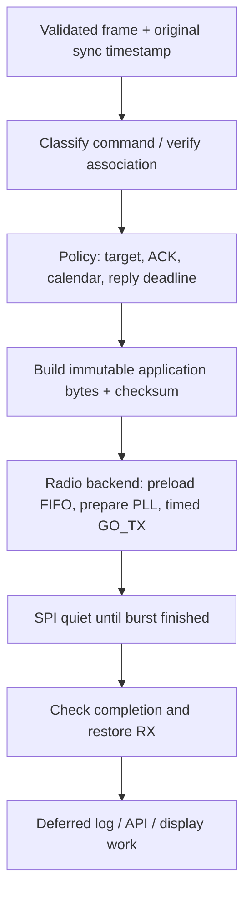

# Implementing a replacement hub

## Receive-first commissioning

1. Identify the product/radio variant and keep the original hub operational.
2. Configure passive RF reception. Save full valid application frames and sync
   timestamps. Do not transmit guessed association messages.
3. Observe repeated 01-01 / 00-01 pairs and learn the thermostat ID, hub ID and
   slot from both directions. Separate neighbouring systems and let the user
   confirm which devices belong to the installation.
4. Keep an immutable registry of associations; never substitute a slot alone
   for the full identity tuple. Learn no printed-serial conversion by guessing.
5. Explicitly remove/disable the original hub before enabling replacement replies.
   Do not let two hubs race to answer the same thermostat.

This procedure reuses an existing association. The original UART taps are a
research aid, not a mandatory feature of a finished user's hub.

## Separate protocol policy from the radio backend



One worker should own the radio bus and registers. HTTP handlers should queue
changes or read cached state, not poll the modem while a packet is being sent.
Separate SPI buses for SD and radio help electrically, but do not prevent a
synchronous SD flush in the radio task from missing a deadline.

Capture the request bytes, identity and sync timestamp together. Do not let an
unrelated later RX event overwrite a shared pending timestamp. Schedule against
the absolute sync deadline, allowing FIFO/PLL preparation beforehand. If a
timestamp is unknown after IRQ recovery, do not invent one and transmit late as
though it were accurate. Reject malformed/unknown commands instead of guessing
an ACK. Reply handling for 01, 05 and 07 should converge on one packet sender.

An implementation-independent outline is:

```text
on radio sync interrupt:
    latch monotonic timestamp once; wake the radio worker

on complete validated application frame:
    check kind + length + approved hub/valve/slot association
    freeze request bytes and its original sync timestamp
    01-01 -> build_status_reply(request, fresh local wall time, policy target)
             absolute GO_TX deadline = request_sync + 53000 us
    01-05 -> build_presence_reply(request)
             absolute GO_TX deadline = request_sync + 27200 us
    01-07 -> validate/cache row; build_program_ack(request)
             absolute GO_TX deadline = request_sync + 35100 us
    other -> retain for analysis; no guessed operating reply
    preload and prepare backend before deadline
    send via the single SPI-quiet packet path; restore RX; defer logs
```

The `build_*` names correspond to the offline helper's byte construction only.
That Python module neither checks a household registry for you nor implements
microsecond scheduling. Run time-critical work on an appropriate controller or
real-time driver; an ordinary HTTP round trip cannot serve as this reply timer.

## Current operational setpoint policy

This is a **replacement policy**, not a property decoded from vendor firmware:

```text
on valid, known 01-01:
    reported = BE16(request[15:17])
    if configured_target is not null and configured_target != reported:
        reply_target = configured_target
    else:
        reply_target = FF FF
    send 00-01 with fresh calendar at request_sync + 53 ms
```

Answer every valid known status even when no new target is needed. A target
remains authoritative until the controller explicitly changes or clears it.
An unchanged local-automation revision is not a reason to skip a needed RF
correction. Later reported equality is the confirmation criterion; record its
delay without claiming that an unobserved earlier confirmation never happened.

This policy corrects both hand-entered and locally scheduled temperature changes.
The known Auto/Manual byte does not reliably distinguish them: a physical
setpoint adjustment was observed while the Auto byte stayed set. Supporting
"manual override wins, schedule loses" would require additional evidence or an
explicit policy/override mechanism, not a confident guess from that byte alone.
If the configured target is null, keep answering while leaving the valve's
setpoint unchanged.

## Calendar

Build 00-01 calendar bytes close to the actual send, using binary year-minus-2000,
month, day, hour, minute and second. No BCD conversion. The reference application
uses Europe/Berlin wall time, including daylight-saving adjustment. That is a
site convention, not a hardwired radio-protocol timezone. Logs use UTC separately.
Use a validated clock and expose a not-ready state if time is missing; one
observed boot waited several minutes before service readiness. Do not silently
start claiming good calendar synchronization with an epoch-zero clock.

## Recovery and observability

- Restore RX after every TX, including errors; report failure explicitly.
- Keep sync candidate, valid frame, checksum failure, FIFO overflow, TX completion
  and reported target confirmation as separate counters.
- When rearming, check for a HIGH IRQ whose rising edge arrived while interrupts
  were disabled. Drain safely; discard any frame whose timing reference is uncertain.
- A heartbeat watchdog can detect a stalled radio worker. The tested reference
  uses 15 seconds without heartbeat, checks once per second and records reset
  cause. It does not reboot merely because the RF channel is quiet.
- Keep reception/service readiness distinct from a stale cached "RX mode" flag.
- Bind persistent targets to identities so a newly assigned slot does not inherit
  another valve's temperature. Do not store secrets in exported device tables.
- Normal operation need not require an SD card. Log asynchronously and support
  bounded RAM queues; preserve heating response timing when storage is slow.

## Minimum independent acceptance tests

1. Parse saved frames and reject checksum/length corruption.
2. Decode real incoming frames matching the original source at the UART/RF boundary.
3. Prove gateway admission in the thermostat-simulation direction if the original
   hub is available; do not treat that as proof of the reverse direction.
4. With the original hub absent, change a real valve target, receive its later
   matching status, and keep normal unchanged-target replies working.
5. Exercise the 01-05 chain, program upload/ACK, restart and error recovery.
6. Run long enough to include hourly traffic and local schedule transitions.

The [offline helper](../tools/protocol.py) covers byte-level work only. An actual
implementation still needs validated modem setup, accurate deadlines, association
selection and local operational/RF requirements.
